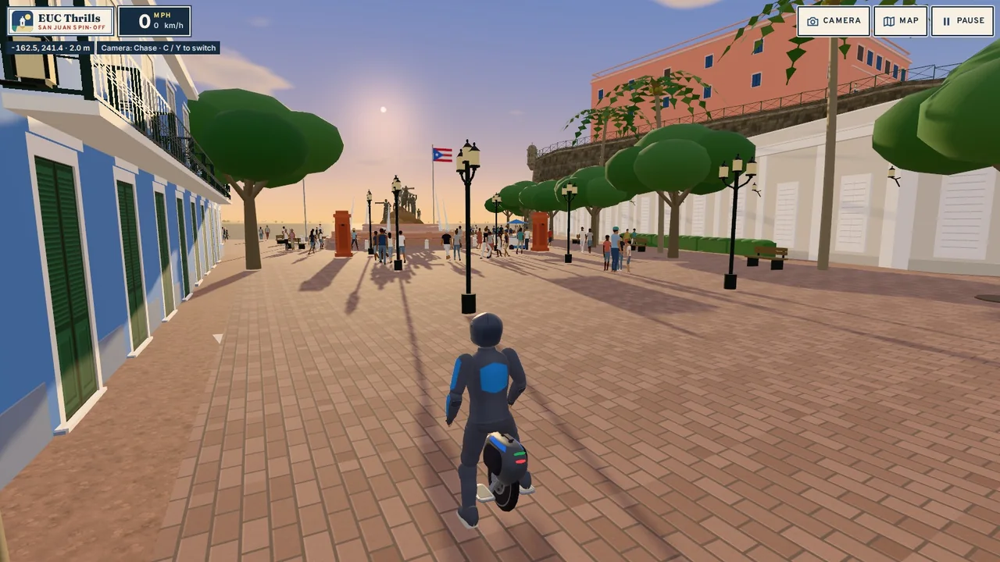
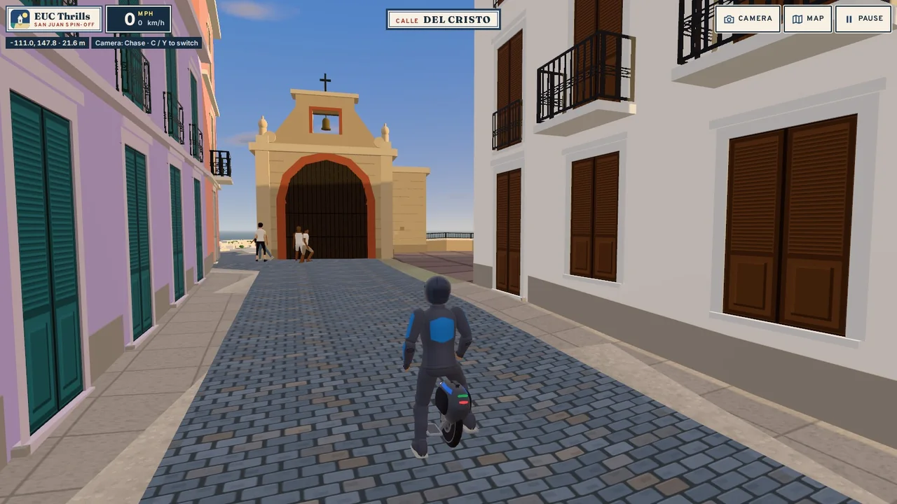
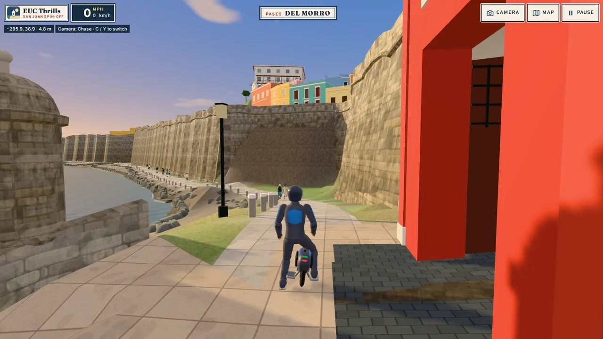
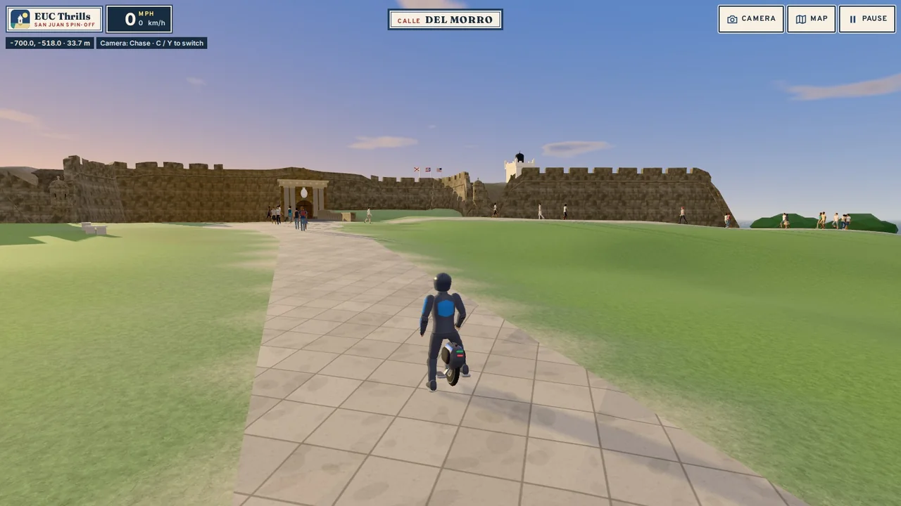
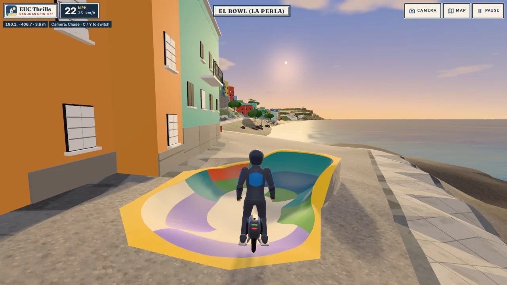
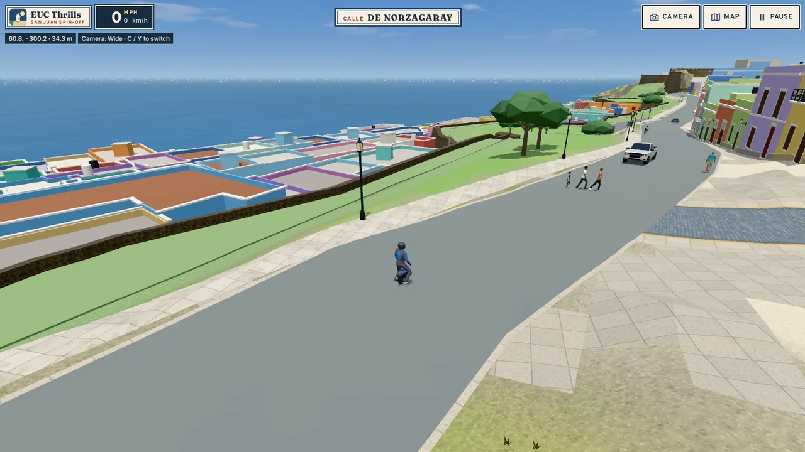
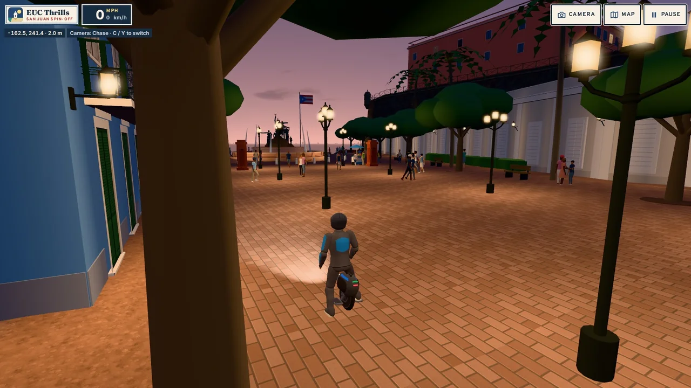
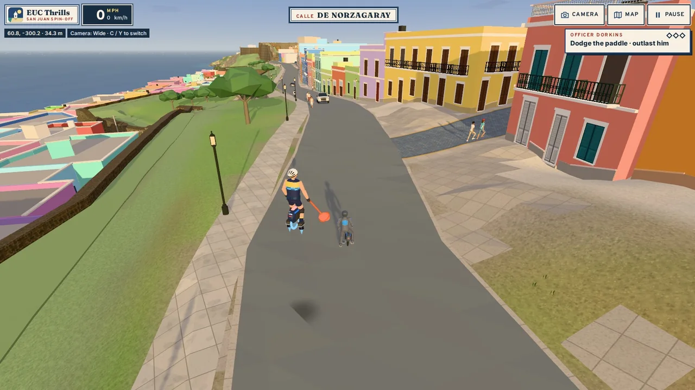
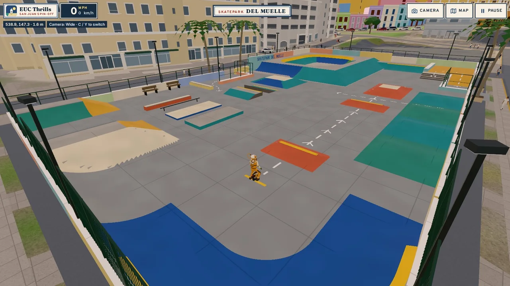
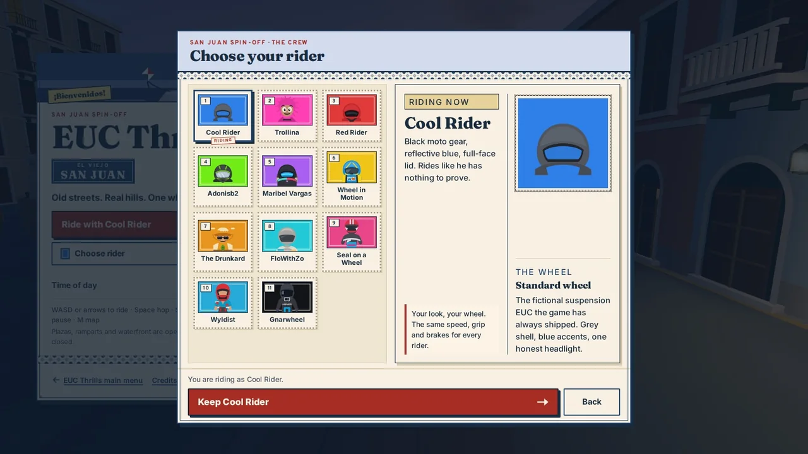

# San Juan Spin-off: EUC Thrills

**[▶ Play in your browser](https://vibezzzcoder.github.io/euc-sanjuan/)** · free · nothing to install · desktop and phone

Ride an electric unicycle through Old San Juan, Puerto Rico, in an original city by VibezZzCoder, creator of
[EUC Thrills](https://github.com/VibezZzCoder/EUC-thrills).

<p align="center">
  <a href="https://vibezzzcoder.github.io/euc-sanjuan/"></a>
</p>

This is *El Viejo San Juan*, the walled old city. Climb the
blue-stone streets, cross the plazas, follow the Paseo del Morro under the city wall, roll out onto the great lawn of
El Morro, drop into La Perla and skate its bowl by the sea. Cars crawl the one-way grid, people fill the plazas, and
Officer Dorkins is somewhere behind you on his hover wheel.

It is a city destination of EUC Thrills, VibezZzCoder's electric-unicycle game, and it also plays on its own. There is no score. Explore, find a line, enjoy the hills.

## An original city

**Old San Juan was built from the ground up for this game by VibezZzCoder. It is not a fork or a reskin of an existing
city project.** This repository began as an empty folder and has its own history.

- **The city is new.** This repository's own tools turn OpenStreetMap geography and a USGS 1 m elevation model into
  the terrain and the street plan. The city on top of that was made here, working from reference photographs: the
  paving and kerbs, some 1,300 buildings and their fronts, the city walls and both forts, the plazas, La Perla, the
  waterfront, the sea, the three hours of light, the riding camera, the traffic lanes and walking routes, and the
  menus. No map, terrain, building, texture or street recording from another city project is in it.
- **The game it belongs to is the same author's.** The wheel's physics, the eleven riders and Officer Dorkins come
  from [EUC Thrills](https://github.com/VibezZzCoder/EUC-thrills), VibezZzCoder's original game.
- **What was reused is credited, file by file.** The New York and San Francisco editions of EUC Thrills are
  adaptations of city projects by Mr.doob and Kamil (@unable0_). San Juan does not use their cities, but some of its
  machinery reached it through those two editions: the page shell and engine integration, input, the vehicle and
  pedestrian figures and their behaviour, the synthesized street sound, Officer Dorkins and the booking, the rider
  swap, and the skatepark construction kit. By count, of the 138 hand-written source files the game runs, 93 (about
  26,000 lines) were written for San Juan and 45 (about 16,000 lines) are adapted from those editions, counting a
  file whole when any real part of it was borrowed. In the adapted files about 7,300 lines of code still match a
  sibling edition, and roughly 2,200 of those lines also appear in Mr.doob's or Kamil's original projects. [provenance/](provenance/README.md) names every such file with its source and hashes,
  and [LICENSE](LICENSE) carries all three copyright lines.

## Screenshots

<p align="center">
  <a href="screenshots/calle-del-cristo.webp"></a>
  <a href="screenshots/paseo-del-morro.webp"></a>
</p>
<p align="center">
  <a href="screenshots/el-morro.webp"></a>
  <a href="screenshots/el-bowl-la-perla.webp"></a>
</p>
<p align="center">
  <a href="screenshots/norzagaray-midday.webp"></a>
  <a href="screenshots/blue-hour.webp"></a>
</p>
<p align="center">
  <a href="screenshots/officer-dorkins.webp"></a>
  <a href="screenshots/skatepark-del-muelle.webp"></a>
</p>

*Frames from the game as it runs in a browser (desktop, WebGPU, 3D resolution 100%, shown at 1280×720; nothing is retouched). Select a gallery image for full size.*

## Play

Open the **[play link](https://vibezzzcoder.github.io/euc-sanjuan/)** in a current browser. The first visit downloads
about 15 MB and builds the whole city before the title appears. Pick a rider and an hour if you like, then press
**Ride**; sound starts with the ride. From there you can cross the whole city without another loading screen;
changing rider takes a moment while their look and sounds are prepared.

- **What you need:** a current browser with WebGPU or WebGL2 and hardware acceleration on. Nothing else.
- **Desktop:** Chrome or another browser with WebGPU gives the best picture; the game falls back to WebGL2 by itself.
- **Phone:** works in portrait and landscape with touch controls, on WebGL2. Where the browser supports it you can
  add the game to the Home Screen (Safari: Share → Add to Home Screen; Chrome: Add to Home screen or Install) and
  open it as its own app.
  It still needs a connection: there is no offline mode.
- **Controller:** standard gamepads work in the game and in every menu.

| | Keyboard and mouse | Controller (Xbox layout) |
|---|---|---|
| Lean forward / brake, then reverse | `W` / `S` or `↑` / `↓` | RT / LT, or left stick |
| Steer | `A` / `D` or `←` / `→` | Left stick |
| Hop (kerbs!) | `Space` | A |
| Charge a bigger hop / tuck | `Shift` | X |
| Get up after a fall | `R` | B |
| Look around | Drag with the mouse, wheel zooms; `I` `J` `K` `L` orbit, `-` `=` zoom, `V` centres | Right stick; press it to centre |
| Camera view: Chase, Wide, Look-around | `C` | Y |
| Map | `M` | Start |
| Pause | `Esc` | View / Back |

Menus work with a controller too: D-pad to move, A to choose, B to go back. On the map, the left stick moves a pointer
over the destination marks and A goes to the one it names; with a mouse, click a mark; by touch, tap a mark and then
its name.

**Touch:** a floating stick under your left thumb steers and sets the speed; **HOP**, **CHARGE** and **GET UP** sit
on the right. Drag anywhere else to look around and pinch to zoom.

Kerbs are real: hop them. The hills are the real hills, so leave room to brake on the way down.

## What is in it

- **The whole old city**, about 1.4 km² of land: some 1,300 buildings on 680 mapped street segments, from La Puntilla
  and the harbour front up to the Atlantic wall, with the real grades. Public stairs are rideable both ways, including
  the Capitol steps.
- **Landmarks you can ride to** on a searchable map whose red marks you can click, tap or point at with a controller: Plaza de Armas, the Cathedral, Capilla del Cristo, Puerta de San
  Juan, Paseo del Morro, El Morro and its lighthouse, Castillo San Cristóbal, Plaza Colón, Paseo de la Princesa and the
  Raíces fountain, La Perla, the cemetery wall, the Capitol and more.
- **Three hours of light:** tropical midday, golden hour (the default) and blue hour, when the lamps, windows and
  floodlit forts come on and the El Morro light turns. Blue hour is the darkest hour on purpose.
- **The sea:** Atlantic swell on the north shore, surf, turquoise shallows over the reef shelf, sun glitter.
- **City life:** parked rows, slow traffic that stops at corners and yields, people on sidewalks, benches and stairs,
  piragua carts, a sky full of kites over the El Morro lawn (flyers, families on blankets and a kite seller below),
  and synthesized street sound.
- **Two skate spots:** *Skatepark del Muelle*, an invented harbour-front park (raised bowl, mini ramp, pump line,
  kickers, a euro gap, a street section), and *El Bowl* in La Perla, the real hand-built community bowl, approximated
  and rideable.
- **Eleven riders** from EUC Thrills, each with their own look, wheel, portrait and crash sounds. The Drunkard rides
  with his hands-off weave; everyone else has the same speed, grip and brakes.

  <p align="center"><a href="screenshots/rider-picker.webp"></a></p>

- **Officer Dorkins**, the nemesis. He arrives from behind, flies over cars, people and street furniture, follows up
  stairs and through the gates, and finds you again after a map trip. A knock-down from his paddle is a warning; after
  three warnings the next one takes you to his paperwork desk, the invented *Cuartelillo del Monociclo*. Watch his
  wind-up: hop a low sweep, turn hard or brake out of a high one. Keep riding under his pressure for about two minutes
  and his battery gives out; standing still or hiding does not count. Pause can send him off duty.
- **Menus drawn from the city's own street furniture:** ceramic street plaques, a tile border, a poster for the
  loading screen. The HUD names the street or plaza you are on.

## Options

Pause sets 3D resolution, a frame limit and an FPS counter, changes rider and hour, and switches Officer Dorkins's
patrol on or off. Rider, hour, resolution, frame limit, the FPS counter and the patrol switch are saved in your
browser.

Address switches (they apply whenever the address carries them and are not saved):

| Add to the address | Effect |
|---|---|
| `?webgpu=0` / `?webgpu=1` | force WebGL2 / ask for WebGPU (phones default to WebGL2) |
| `?time=midday`, `?time=golden`, `?time=blue` | start at that hour |
| `?rider=<id>` | start as that rider, for example `?rider=trollina` |
| `?cop=0` | no Officer Dorkins at all |
| `?life=0` | no moving cars, people, street sound, piragua carts or kites |
| `?parked=0` | no parked cars (and nothing to hit where they stood) |
| `?cars=N`, `?people=N` | cap moving cars or people; 0 turns that population off, and `?people=0` also removes the carts and kites |
| `?accents=0` | no piragua carts, kites or picnics on the El Morro lawn, everything else as usual |

## Known limits

This is the first public release. It has been played in desktop Chrome and on an iPhone, including as a Home Screen
app, and its menus and touch handling are checked on current and older WebKit. Other browsers and devices may behave
differently.

- **One known hiding place beats Officer Dorkins.** If you stop inside the tunnel through the city wall on Calle
  Cementerio during a chase, he cannot reach you and waits above it. Ride out and the chase goes on.
- **Dorkins is a flyer, not a solid body.** When he cannot reach you he drops out of sight and comes back in from
  behind the camera. Losing him by distance alone is close to impossible; outlasting him is the way out. His desk is
  scenery for the booking only.
- **City life is local.** Cars use a connected subset of the streets (none in La Perla, the tunnels or Puerta de San
  Juan), and people and traffic gather around the rider instead of filling every block at once. Some streets are much
  quieter than the plazas and the waterfront, and a few sidewalks too narrow to walk stay empty.
- **Cars brake for you, mostly.** A rider who cuts into a lane right in front of a car can still be hit. Hitting a
  person at speed crashes the rider, as hitting any obstacle does.
- **Small visual slips:** two people heading for neighbouring bench seats can overlap for a moment, a walker can stand
  slightly off the ground on a few uneven spots, and the camera can bump or pull in close when you orbit it into a
  wall or a tunnel mouth.
- **Light and water:** blue hour is deliberately dim away from the lamps, which are baked light without per-lamp
  shadows. The sea is drawn with waves but is physically flat, and a rider who ends up in it is put back on dry ground.
- **Closed places stay closed:** fort interiors, some gates, the cemetery and the Coast Guard base. A place on the map
  is somewhere to arrive, not a promise that every route between two places is rideable.
- **It is a game, not a survey.** Building shapes, heights and colours are simplified or inferred from mapped
  footprints and photographs.
- Riders differ in look, wheel and sound; only The Drunkard rides differently. Text in the game cannot be selected or
  copied, except in the map's search box.

Found something broken? [Open an issue](https://github.com/VibezZzCoder/euc-sanjuan/issues) with your browser and
device, the build line from the bottom of the Pause menu, and the position line shown under the speedometer.

## Run it locally

The game is plain HTML, CSS and JavaScript modules with no build step and no dependencies to install. Three.js, the
fonts and all data are in the repository.

```bash
python3 tools/serve.py
```

Then open **http://127.0.0.1:8004** on the same machine (if that port is taken, `python3 tools/serve.py --port 8010`
and open that port instead). To play from another device, use a web server that device can reach; over plain HTTP on
a network address browsers do not offer WebGPU, so the game uses WebGL2 there.

Checks (Node.js 22.15 or newer, Python 3.9+):

```bash
node --test tests/*.test.mjs        # headless tests
node tools/csp.mjs --check          # Content-Security-Policy matches the inline scripts
node tools/vendor-three.mjs --check # vendored three.js and fonts match vendor/MANIFEST.json
node tools/build-streets-cache.mjs --check
node tools/actors-provenance.mjs --check
python3 tools/package.py            # portable copy of the runtime files in dist/
```

`node tools/vendor-euc.mjs --check` verifies the installed EUC modules, licence and audio without an upstream checkout. To compare them with a fresh generation, use two clean EUC Thrills Git checkouts: base `5f45fff19b258e140833841ba2473069af751a12` and code donor `d37efc07cddc0d76ff7aa585901710d357b8e5a1`. Run `npm ci` in the base checkout to supply TypeScript, then run this from San Juan (substitute the two directory paths):

```bash
node tools/vendor-euc.mjs --check --src /path/to/base --donor /path/to/donor --no-preloads
```

Neither upstream checkout nor GIS tooling is needed to play the game. The page loads everything from its own address
and carries a Content-Security-Policy that refuses anything else; `SHA256SUMS.txt` lists the hash of every other
file.

## Build on the city

Want to make a walking tour, a different riding game or something else in Old San Juan? The
[fork guide](FORK_GUIDE.md) shows how to load the city without the EUC game shell, adapt its terrain and collision
to your own game, and carry over the right credits. The code is MIT and the map data is ODbL, so you may. Two things
are asked of you: keep the credits that the licences require, and give your game its own name and its own
characters. Eight of the eleven riders portray real people; the open licences do not cover their identities, their
logos or the recordings they contributed. The fork guide lists the terms file by file.

## License and data

- **Code:** MIT. See [LICENSE](LICENSE) (© 2026 Mr.doob; © 2026 Kamil (@unable0_), San Francisco contributions;
  © 2026 VibezZzCoder, EUC adaptation and San Juan work) and [js/euc/LICENSE](js/euc/LICENSE) for the EUC Thrills
  riding engine.
- **Engine integration:** the page shell, the rider and audio integration, the support and collision store and the
  input code adapt the [San Francisco edition](https://github.com/VibezZzCoder/euc-sanfrancisco) of EUC Thrills,
  including Kamil's and Mr.doob's work where inherited. See
  [provenance/sf-import.json](provenance/sf-import.json) for each file and its hash before adaptation. No San
  Francisco or New York world data came with it.
- **Riders and Officer Dorkins:** the rider-choice transaction, the chase and the booking adapt the
  [San Francisco edition](https://github.com/VibezZzCoder/euc-sanfrancisco) of EUC Thrills (MIT, VibezZzCoder); several
  parts of the chase and the booking were first written for its New York edition. See [provenance/riders-import.json](provenance/riders-import.json) and
  [provenance/dorkins-import.json](provenance/dorkins-import.json) for the files and what changed. The picker's
  design, his routes through this city, his pace, the desk and the booking's words were made for San Juan. The
  riders' portraits are the drawings from EUC Thrills v1.1.0, unchanged; three carry the rider's own logo. Officer
  Dorkins and the *Cuartelillo* are fictional and carry no real police or agency marks.
- **City life:** vehicle lofts and street sound adapt the [New York edition](https://github.com/VibezZzCoder/euc-nyc)
  of EUC Thrills and its Mr.doob lineage. Traffic, pedestrian figures and reactions, and actor collisions adapt
  the [San Francisco edition](https://github.com/VibezZzCoder/euc-sanfrancisco), including Kamil's and Mr.doob's
  work where inherited. See [the exact source record](provenance/actors-import.json) for the MIT code.
  San Juan's own liveries, parked rows, wardrobe, lanes and walks were made for this city; the liveries carry no
  real maker, company or agency marks. Lane and walk routes derive from OSM data (ODbL); their algorithms are MIT.
- **Skate spots:** the construction kit adapts the San Francisco edition's skatepark kit and the Foundry Yard
  profiles of the original EUC Thrills (MIT, VibezZzCoder); see [provenance/skate-import.json](provenance/skate-import.json).
  The sites, layouts, paint and lettering were made for San Juan. El Bowl approximates the real bowl built by hand
  in La Perla in 2006 by Chemi Rosado-Seijo with Roberto "Boly" Cortez, Luiggi Ramos, residents and visiting skaters.
- **EUC Thrills assets:** original licensed assets are [CC BY 4.0](https://creativecommons.org/licenses/by/4.0/),
  with exceptions for real riders' identities, logos, contributed recordings and generated vocal layers.
  Attribute as:

  > Assets from *EUC Thrills* by VibezZzCoder — CC BY 4.0 — https://github.com/VibezZzCoder/EUC-thrills

  The full notice, its exceptions and per-file audio rights are in [NOTICE-EUC-THRILLS.md](NOTICE-EUC-THRILLS.md)
  and [audio/euc/PROVENANCE.md](audio/euc/PROVENANCE.md). Read [FORK_GUIDE.md](FORK_GUIDE.md) before reusing riders.
- **Map data:** [© OpenStreetMap contributors](https://www.openstreetmap.org/copyright), under the
  [Open Database Licence (ODbL) 1.0](https://opendatacommons.org/licenses/odbl/1-0/).
  The OSM-derived data in `data/` and the build rules in `tools/` are part of this repository; sources, query text
  and hashes are in [provenance/geodata.json](provenance/geodata.json).
- **Elevation:** USGS 3D Elevation Program (3DEP) 1 m DEM, public domain, resampled for the game. It is not a claim
  of survey accuracy, and no endorsement by USGS is implied.
- **three.js:** MIT, vendored at a pinned commit; see `vendor/three/LICENSE` and `vendor/MANIFEST.json`.
- **Fonts:** Inter and Overpass (`fonts/`) and Fraunces (`assets/type/`) under the SIL Open Font License 1.1.

More detail: [NOTICE.md](NOTICE.md), [LICENSING.md](LICENSING.md), [provenance/README.md](provenance/README.md).

[Local credits, source and geographic data downloads](credits.html).

